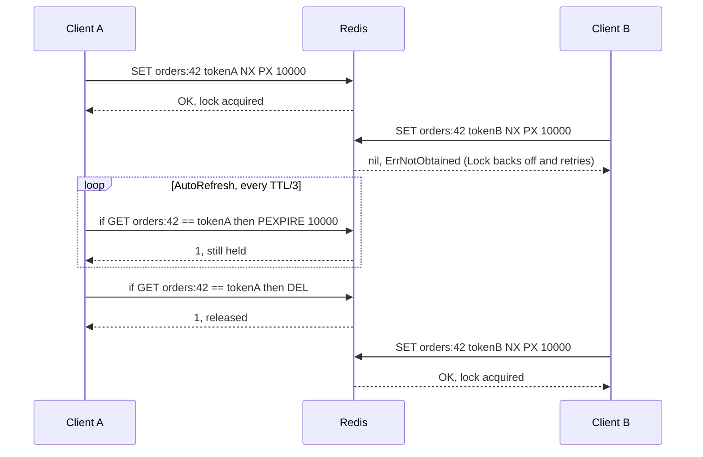

# go-redislock

[](https://github.com/yohadrian21/go-redislock/actions/workflows/ci.yml)
[](https://pkg.go.dev/github.com/yohadrian21/go-redislock)
[](LICENSE)

Distributed locks for Go on Redis, built on [go-redis v9](https://pkg.go.dev/github.com/redis/go-redis/v9).

It is a small library that does one thing carefully:

- **Safe acquire**: `SET key token NX PX ttl` with a random token per lock.
- **Safe release and extension**: Lua compare-and-delete and compare-and-expire scripts, so a client never releases or extends a lock that has expired and been taken by someone else.
- **Blocking or non-blocking**: `TryLock` makes one attempt. `Lock` waits with context support, exponential or constant backoff, jitter, and an optional retry limit.
- **Watchdog**: `AutoRefresh` keeps a lock alive during long work and cancels a context the moment the lock is lost.
- **Fencing tokens**: an `INCR` counter, issued atomically with the lock, that lets the protected resource reject stale writers.
- **Clear errors**: `ErrNotObtained` and `ErrNotHeld` sentinel errors, usable with `errors.Is`.

## Install

```sh
go get github.com/yohadrian21/go-redislock
```

Requires Go 1.26 or newer, the same as go-redis v9.23. It works with any Redis server that supports Lua scripting; CI runs against Redis 8.

## Quick start

```go
package main

import (
	"context"
	"log"
	"time"

	"github.com/redis/go-redis/v9"
	"github.com/yohadrian21/go-redislock"
)

func main() {
	rdb := redis.NewClient(&redis.Options{Addr: "localhost:6379"})
	defer rdb.Close()

	locker := redislock.New(rdb)

	// Wait up to 5 seconds for the lock, then hold it for at most 30 seconds.
	ctx, cancel := context.WithTimeout(context.Background(), 5*time.Second)
	defer cancel()

	lock, err := locker.Lock(ctx, "invoice:42", 30*time.Second)
	if err != nil {
		log.Fatal(err) // errors.Is(err, redislock.ErrNotObtained) if it timed out
	}
	defer lock.Unlock(context.Background())

	// ... work that must not run concurrently ...
}
```

## Usage

### TryLock or Lock

`TryLock` makes a single attempt and returns `ErrNotObtained` if someone else holds the lock. It suits jobs that should be skipped rather than queued:

```go
lock, err := locker.TryLock(ctx, "report:nightly", time.Minute)
if errors.Is(err, redislock.ErrNotObtained) {
	return nil // another worker is already on it
}
```

`Lock` retries until it gets the lock, the context ends, or the retry budget runs out. Tune it with options:

```go
lock, err := locker.Lock(ctx, "inventory:sku-123", 10*time.Second,
	redislock.WithBackoff(redislock.ExponentialBackoff(20*time.Millisecond, time.Second)),
	redislock.WithJitter(1),      // "full jitter": each delay is random in (0, d]
	redislock.WithMaxRetries(20), // default: retry until ctx is done
)
```

| Option | Default | Effect |
| --- | --- | --- |
| `WithBackoff(b)` | `ExponentialBackoff(10ms, 500ms)` | Delay before each retry. `ConstantBackoff(d)` and `ExponentialBackoff(base, limit)` are provided, or pass any `func(retry int) time.Duration`. |
| `WithJitter(f)` | `0.5` | Randomizes each delay `d` to `(d - f*d, d]`, so competing clients don't retry in lockstep. |
| `WithMaxRetries(n)` | unlimited | Stop after `n` retries. `0` makes `Lock` behave like `TryLock`. |
| `WithFencing()` | off | Issue a fencing token with the lock (see below). |

If the context ends first, the error wraps both `ErrNotObtained` and the context error, so `errors.Is(err, context.DeadlineExceeded)` works too. Connection and server errors are returned immediately rather than retried.

### Refresh, TTL and Unlock

```go
err := lock.Refresh(ctx, 30*time.Second) // reset the TTL; ErrNotHeld if the lock was lost
ttl, err := lock.TTL(ctx)                // time left; ErrNotHeld if the lock was lost
err = lock.Unlock(ctx)                   // release; ErrNotHeld if it had already expired
```

### Keeping a lock alive while you work

For work that may outlast the TTL, start the watchdog. It refreshes the lock every third of its TTL and returns a context that is canceled with cause `ErrNotHeld` if the lock is lost, either because a refresh found it gone or because Redis stayed unreachable until the TTL ran out:

```go
ctx, stop := lock.AutoRefresh(ctx)
defer stop()

err := migrate(ctx) // returns early once ctx is canceled
if errors.Is(context.Cause(ctx), redislock.ErrNotHeld) {
	return fmt.Errorf("lost the lock mid-migration: %w", err)
}
return err
```

### Fencing tokens

```go
lock, err := locker.Lock(ctx, "ledger:7", 10*time.Second, redislock.WithFencing())
// ...
db.Exec(`UPDATE ledgers SET balance = $1, fence = $2 WHERE id = $3 AND fence <= $2`,
	balance, lock.FencingToken(), 7)
```

Tokens for a key increase with every acquisition. The section [Why fencing tokens matter](#why-fencing-tokens-matter) explains when you need them.

## How it works

A lock is a single Redis key whose value is a random token unique to the holder and whose TTL bounds how long the lock can be held if the holder disappears.



- **Acquire**: `SET key token NX PX ttl` creates the key only if it does not exist. It runs inside a small Lua script so that, with `WithFencing`, `INCR key:fence` happens in the same atomic step and a newer holder always gets a larger token.
- **Release, refresh and TTL**: each is a Lua script that first checks `GET key == token`. Without that check, a client whose lock had expired could delete or extend the lock of whoever acquired it next.
- **Watchdog**: `AutoRefresh` refreshes every TTL/3, so one or two failed refreshes don't lose the lock. It also runs a local timer, reset after each successful refresh, that cancels the context once the lock may have expired. That way work stops on time even while a refresh is stuck waiting for an unreachable server.

Scripts are sent with `EVALSHA` and fall back to `EVAL` if the server's script cache was flushed.

## Caveats

Distributed locks are easy to get subtly wrong. These are the trade-offs of this design.

### A single-instance lock is not Redlock

All lock state lives on one Redis primary. That is simple and fast, but Redis replication is asynchronous. If the primary fails after granting a lock and before the write reaches a replica, the promoted replica has never heard of the lock and will grant it again, so for a moment two clients hold it. A restart without persistence has the same effect. Losing data also resets fencing counters, so tokens issued afterwards can repeat old values.

This library deliberately does not implement [Redlock](https://redis.io/docs/latest/develop/clients/patterns/distributed-locks/), which acquires a lock on a majority of independent Redis primaries. Redlock narrows the failover window but relies on its own timing assumptions, which are [debated](https://martin.kleppmann.com/2016/02/08/how-to-do-distributed-locking.html) [at length](https://antirez.com/news/101). In practice:

- Use this lock for **efficiency**, to stop duplicate work like two workers sending the same email. An occasional double run is acceptable there.
- When **correctness** depends on the lock, also use fencing tokens, or use a consensus system such as etcd or ZooKeeper.

In Redis Cluster, `WithFencing` touches two keys, which must share a hash slot. Put the lock name in a hash tag, such as `{orders:42}`, so the counter `{orders:42}:fence` lands on the same node.

### Clocks and TTLs

- **The TTL is all you are guaranteed.** Network delays, GC pauses and a stalled process all eat into it, and the holder cannot tell from inside a pause that time has passed. Choose a TTL well above the expected critical section plus the worst pause you can tolerate, and use `AutoRefresh` when the duration is unpredictable.
- **Two clocks are involved.** Redis expires keys by its own clock. Client-side, this library only measures time with Go's monotonic clock and counts conservatively from *before* each request was sent. A large wall-clock jump on the Redis host, such as an NTP step, can still make locks expire early or late, so keep server clocks synced with slewing.
- **Millisecond precision.** TTLs are sent as whole milliseconds and rounded down. The minimum is 1ms.
- **A `*Lock` is not proof of ownership.** After a TTL expires, the `*Lock` value still exists, but `Refresh`, `TTL` and `Unlock` return `ErrNotHeld`.

### Why fencing tokens matter

No expiring lock can, on its own, protect against this sequence:

1. Client A acquires the lock and starts writing.
2. A stalls, perhaps on a long GC pause, past the TTL. The lock expires.
3. Client B acquires the lock and writes.
4. A resumes, still believing it holds the lock, and overwrites B's data.

A cannot detect step 2 because it was not running. The fix has to happen where the data lives. With `WithFencing`, every acquisition gets a strictly larger token. Send the token with each write and have the storage reject writes whose token is lower than the highest it has accepted, for example with a conditional `UPDATE ... WHERE fence <= $token`. A's late write then carries token 1 after B's token 2 and is refused. [`examples/fencing`](examples/fencing/main.go) runs this scenario end to end.

## Examples

Runnable examples are on [pkg.go.dev](https://pkg.go.dev/github.com/yohadrian21/go-redislock#pkg-examples). Full programs live in [`examples/`](examples). Each needs a Redis server at `localhost:6379` or `$REDIS_ADDR`:

| Program | Shows |
| --- | --- |
| [`examples/basic`](examples/basic/main.go) | `Lock` with a timeout, `TryLock`, `TTL`, `Unlock` |
| [`examples/watchdog`](examples/watchdog/main.go) | `AutoRefresh` keeping a lock alive; add `-lose-lock` to see the job abort |
| [`examples/fencing`](examples/fencing/main.go) | A stale holder's write rejected by its fencing token |

```sh
docker run --rm -d -p 6379:6379 redis:8
go run ./examples/fencing
```

## Development

```sh
go test -race ./...                            # unit tests and examples on an in-memory miniredis
REDIS_ADDR=localhost:6379 go test -race ./...  # also runs the integration tests on a real Redis
golangci-lint run
```

Unit tests use [miniredis](https://github.com/alicebob/miniredis), so expiry can be fast-forwarded deterministically. Integration tests run against a real server to check real-time expiry, the watchdog, lost locks, and mutual exclusion across 50 competing goroutines. CI runs everything with the race detector on Go 1.26 and 1.27 against Redis 8.

## License

[MIT](LICENSE) © 2026 Yohanes Adrian Risangtomo
